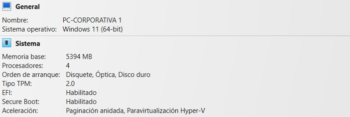
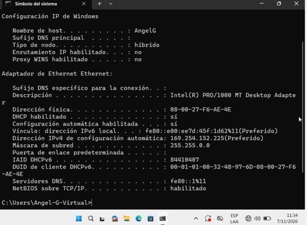
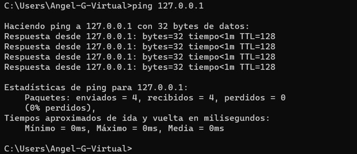
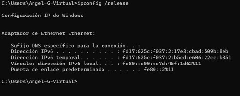
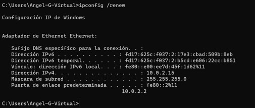

# Reporte Técnico (Entorno Simulado)

## 1. Título del Incidente
- **Ticket:** #001
- **Prioridad:** Alta
- **Asunto:** Pérdida de conectividad por fallo eléctrico nocturno.

## 2. Escenario
El equipo de soporte técnico recibe un mensaje urgente el cual menciona lo siguiente: 

> *"Buenos días equipo de soporte técnico, nos encontramos en la oficina y tenemos el inconveniente de que no hay conectividad en nuestros computadores. Lo que nos mencionan es que el día de ayer surgió un apagón en todo el edificio."*

## 3. Overview
Para llevar a cabo este escenario simulado, usamos como herramienta una máquina virtual en VirtualBox con las siguientes características:

Para generar el escenario del problema usamos la configuración de red:

El uso de **"Red interna"** al configurar la red nos permite mostrar un escenario en el cual la conexión física se encuentra en buen estado, pero el problema es que no existe un servidor DHCP. 

Esta configuración nos permite plantear nuestro escenario simulado sin conexión a internet:

## 4. Metodología de Diagnóstico
Para dar solución a este problema ingresamos al CMD desde nuestro computador para evaluar el estado del adaptador e identificar la falla:

- Identificamos la IP asignada a nuestro computador mediante `ipconfig /all`:

Podemos identificar en este caso que la dirección es `169.254.152.225`, una IP de respaldo APIPA. Esto nos muestra que el daño puede ser físico (cableado) o un problema con el servidor DHCP, ya que la máquina no recibió una IP propia de la red.

- Para descartar que la tarjeta de red del computador presente un daño físico o lógico, realizamos ping a la misma mediante `ping 127.0.0.1`:

No existe pérdida de datos (0% perdidos), por lo que descartamos daño en la tarjeta de red. Para este caso, hemos identificado que el problema es con la asignación DHCP, la cual puede ser a causa de un daño físico o saturación/bloqueo del servidor tras el apagón.

## 5. Solución
Luego de identificar el problema y realizar la revisión física de equipos y cableado, concluimos que existe un bloqueo o saturación en el servidor DHCP y procedemos con el reinicio del mismo.

En nuestro caso simulado, cambiamos el adaptador de red en VirtualBox a **NAT** para que la VM actúe como router y le asigne una IP por DHCP:

Luego, para evitar problemas de asignación, ejecutamos los siguientes comandos en la consola CMD:

- `ipconfig /release`: Borra la IP asignada (en este caso la APIPA de emergencia).

- `ipconfig /renew`: Activa el ciclo D.O.R.A. para una reasignación nueva de IP.

Con esto confirmamos que contamos con una IP válida (`10.0.2.15`) además de ingresar correctamente a internet:

## 6. Conclusiones
En este caso en particular pudimos ver en un entorno simulado cómo un apagón puede generar que el servidor DHCP sufra un bloqueo o saturación, causando que la empresa pierda su conectividad. 

La solución fue diagnosticar desde adentro hacia afuera para evitar pérdida de tiempo y encontrar rápidamente el daño. Mediante `ipconfig /all` se evaluó que el dispositivo no tenía una IP válida. Se descartó falla local con el ping a loopback, se procedió a restablecer el servicio DHCP y, mediante `ipconfig /release` e `ipconfig /renew`, se reinició el ciclo D.O.R.A. asignando una IP válida nuevamente y confirmando la conectividad al navegar en internet. 

Para evitar esto a futuro, se recomienda contar con una fuente de respaldo (UPS) que mantenga el servidor DHCP encendido en caso de pérdida de energía.
